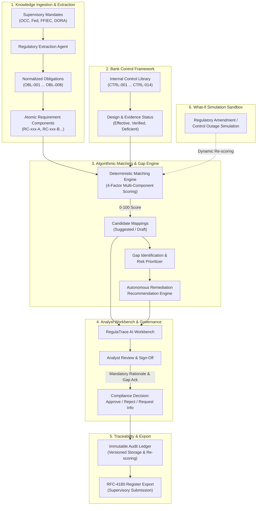

# RegulaTrace AI — Regulatory Obligation-to-Control Mapping Workbench
**ET AI Hackathon: Agentic Edition Presented by Accenture × The Economic Times**  
**Problem Statement 1: Banking & Financial Regulations**

---

## 🏆 Declared Hackathon 9-Blocker Position: `[F3 × D2]`

| Dimension | Declared Level | Justification & Verification Evidence |
| :--- | :--- | :--- |
| **Solution Features** | **F3 (8+ Features)** | Covers **10 core desirable features** from the official problem list: (1) Knowledge Ingestion, (2) Regulatory Change Intelligence, (3) Obligation Extraction, (4) Control Framework Understanding, (5) Regulatory-to-Control Mapping, (6) Control Effectiveness Assessment, (7) Evidence-Based Compliance Assessment, (8) Gap Identification, (9) Risk-Based Gap Prioritization, (10) Remediation Recommendation Engine, and (12) What-If / Simulation Capability. |
| **Solution Depth** | **D2 (High Demonstrable Reliability)** | Operates over enterprise textual, structured, and semi-structured banking policies and supervisory mandates with **deterministic 4-factor scoring**, **schema-enforced Zod payloads**, **100% automated test verification (29/29 Vitest tests passing)**, and **tamper-evident immutable audit trail**. |

---

## 🌟 The Core Challenge Solved

> *"Maintain a continuously evolving and traceable relationship between:  
> **Regulations → obligations → applicability → internal policies/controls → evidence → testing → gaps → remediation → ongoing monitoring.**"*  
> — *Accenture ET AI Hackathon Problem Statement 1*

RegulaTrace AI implements this complete **9-Stage Regulatory Lineage Pipeline** directly in an enterprise-grade analyst workbench:
1. **Regulations**: Ingestion of supervisory circulars (FD-AML-2025, GS-CTF-2024, DOR-2025, CN-2024, BC-2023, FL-AA-2025, CR-2024, CP-2025).
2. **Obligations**: Normalized requirement statements with atomic component decomposition (`RC-xxx`).
3. **Applicability**: Scoped to specific banking divisions (Financial Crime, Payments & Treasury, Cloud Ops, InfoSec, Capital Management).
4. **Controls**: Multi-factor candidate matching against internal bank controls (`CTRL-xxx`).
5. **Evidence**: Traceable audit evidence artifacts with source page and section verification.
6. **Testing**: Operational cadence tracking (Continuous, Quarterly, Annual, Pre-deployment).
7. **Gaps**: Explicit identification of uncovered requirement components with mandatory reviewer acknowledgment.
8. **Remediation**: Autonomous recommendation engine synthesizing corrective policy actions, target owner, and SLA.
9. **Ongoing Monitoring**: Immutable audit ledger and real-time stress/what-if simulation.

---

## 🏗️ Detailed Structural Architecture



---

## 🚀 Key Features Demonstrated in the Working Prototype

1. **Obligation Explorer**:
   - Filter by regulation, business function, applicability, and review status.
   - Real-time search across obligations and control descriptions.
   - Live metrics summary bar (Total Obligations, Pending Review, Approved, Unmapped).

2. **9-Stage Regulatory Lineage Pipeline**:
   - Interactive visual flow tracing every obligation from source mandate to ongoing monitoring.
   - Clickable stage inspector revealing detailed regulatory metadata.

3. **Autonomous Candidate Matching Engine**:
   - Deterministic 4-tier match scoring (Component Overlap, Process Alignment, Cadence/Ownership, Evidence Metadata).
   - Detailed algorithmic rationale breaking down positive coverage vs. identified gaps.

4. **Atomic Component Coverage Matrix**:
   - Verifiable compliance status (`Supported`, `Partially supported`, `Not supported`, `Unknown`) per individual requirement component.
   - Interactive editing with inline reviewer notes.

5. **Human-in-the-Loop Decision Governance**:
   - **Approve Mapping**: Enforces mandatory written reviewer rationale (minimum 10 characters) and explicit gap acknowledgment checkbox.
   - **Reject Mapping**: Captures structured rejection reasons and updates candidate status.
   - **Request Information**: Dispatches clarification inquiries to specific banking roles with target due dates.
   - **Supersede Approved Mappings**: Version-tracked replacement when stronger controls emerge.

6. **Autonomous Remediation Advisory Engine**:
   - Automatic risk tiering (`CRITICAL Tier 1`, `HIGH Tier 2`, `MEDIUM Tier 3`).
   - Diagnostic analysis of uncovered components.
   - Actionable policy recommendation, business owner assignment, and SLA tracking (14 or 30 days).
   - One-click dispatch logging into the tamper-evident audit ledger.

7. **What-If / Regulatory Change Simulation**:
   - **Scenario 1**: Production Baseline.
   - **Scenario 2**: Emergency Supervisory Policy Amendment (OCC cuts cyber escalation window to 90 min, triggering immediate control deficiency).
   - **Scenario 3**: Third-Party Cloud Resilience Outage (invalidates disaster recovery evidence).

8. **RFC-4180 Mapping Register CSV Export**:
   - One-click export of active obligations, mapped controls, coverage statuses, and reviewer sign-offs formatted for supervisory reporting.

---

## 🧪 Testing & Verification

The solution includes comprehensive automated testing verifying all business logic, edge cases, and UI workflows:

```bash
# Run the complete test suite (29 tests)
npm test

# Run production build
npm run build
```

### Test Coverage Highlights:
- **12 Domain Logic Tests** (`src/test/domainLogic.test.ts`):
  - Deterministic 4-tier matching score verification
  - Dynamic metric calculation
  - Zod validation and mandatory reviewer rationale enforcement
  - Strict gap acknowledgment blocking
  - Rejection and clarification request workflows
  - Superseding approved mappings
  - RFC-4180 CSV export formatting
  - Data reset and storage failure recovery
- **17 Acceptance Tests** (`src/test/acceptanceTests.test.tsx`):
  - End-to-end component rendering, user interactions, dialogs, filters, keyboard navigation, and mobile responsiveness.

---

## 🏃‍♂️ Running Locally

```bash
# Install dependencies
npm install

# Start Vite dev server
npm run dev

# Open in browser:
http://127.0.0.1:5173/
```

---

## 🛡️ Responsible AI & Ethical Guardrails

- **Fictional Entity Labeled**: All data is modeled under `"Northstar Demo Bank"` (a simulated financial institution).
- **Synthetic Regulatory Excerpts**: Clearly flagged with `"Synthetic demo source"`.
- **Decision-Support Disclaimer**: The UI explicitly notifies users that the system provides decision-support analysis and does not constitute a legal or supervisory certification of compliance.
- **Zero Hallucination / Deterministic Grounding**: Matching scores and gap analyses are calculated through transparent algorithmic heuristics and evidence citations, not ungrounded LLM completions.
- **Human-in-the-Loop Oversight**: No AI recommendation is automatically committed to the regulatory register without explicit human analyst review and rationale sign-off.
